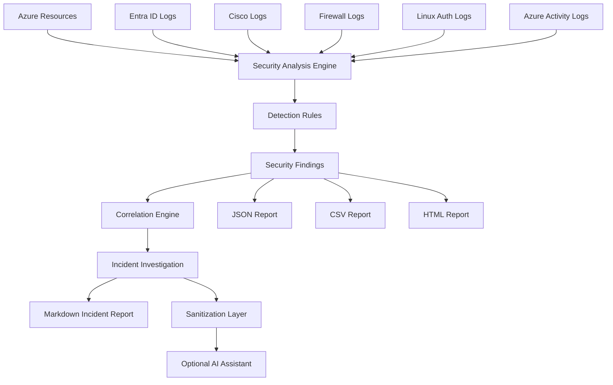

# NovaTech Security Lab

Python-based cloud and security engineering lab that analyzes simulated Azure, Entra ID, Cisco, firewall, and Linux telemetry to identify security risks, correlate suspicious activity, investigate incidents, and generate reports.

The project demonstrates practical security engineering skills including detection logic, log parsing, cloud security configuration analysis, IAM/RBAC analysis, network security analysis, correlation, incident investigation, rule-based detection, secure AI integration, and automated reporting.

---

## Key Features

- Azure cloud security configuration scanning
- Entra ID identity and RBAC analysis
- Cisco network authentication analysis
- Firewall traffic and port-scan detection
- Linux authentication and privilege escalation analysis
- Cross-source security event correlation
- Indicator hunting across network logs
- JSON-driven detection rules
- Incident investigation timelines
- Sensitive-data sanitization before external AI use
- Optional evidence-grounded AI investigation assistance
- Markdown incident reports
- Automated JSON, CSV, and HTML security reports
- Command-line security analysis interface

---

## Architecture



---

## Security Data Sources

The lab uses simulated security telemetry representing a hybrid enterprise environment.

### Cloud

- Azure virtual machines
- Storage accounts
- SQL databases
- Key Vault
- Virtual networks
- Network Security Groups
- Azure Activity Logs

### Identity

- Entra ID users
- RBAC role assignments
- Entra ID sign-in events

### Network

- Cisco switch authentication logs
- Cisco administrative activity

### Firewall

- Cisco ASA firewall traffic logs

### Endpoint

- Linux SSH authentication logs
- Linux sudo activity

---

## Environment Inventory

The inventory engine dynamically analyzes the supplied environment data.

Example:

```text
NOVATECH ENVIRONMENT

Virtual Machines       2
Storage Accounts       2
SQL Databases          1
Key Vaults             1
VNets                  1
NSGs                   2
Users                  8
Privileged Users       3
Network Devices        2
```

---

## Cloud Security Detection

The cloud analyzer identifies insecure Azure configurations such as:

- Publicly exposed virtual machines
- Password-based SSH authentication
- Missing managed identities
- Public storage access
- Weak TLS configuration
- Public SQL access
- Disabled SQL auditing
- Overly broad SQL firewall rules
- Public Key Vault access
- Secrets without expiration dates
- Internet-exposed SSH and RDP
- Overly permissive NSG rules

Example:

```text
[Critical] CLOUD-NSG-001

Resource: nsg-web
Reason: SSH is exposed to the Internet.
Evidence: source=0.0.0.0/0, port=22
```

---

## Identity and RBAC Analysis

The identity analyzer evaluates Entra ID users, role assignments, and authentication activity.

Detections include:

- Subscription Owner assignments
- Contributor privileges
- Stale privileged accounts
- Repeated authentication failures
- Successful login after repeated failures
- Privileged authentication from unusual external sources

Example:

```text
[Critical] IAM-AUTH-002

Identity: netadmin@novatech.example
Reason: Successful sign-in occurred after repeated failures.
Evidence:
source_ip=198.51.100.77
previous_failures=3
threshold=3
```

---

## Cisco Security Analysis

Cisco logs are parsed into structured events and analyzed for suspicious administrative activity.

Detections include:

- Repeated administrator login failures
- Successful login after repeated failures
- Configuration changes after suspicious authentication
- Repeated activity from the same source IP

Example:

```text
[Critical] NET-CONFIG-001

Device: CORE-SW01
Reason: Configuration change occurred shortly after suspicious authentication.
Source IP: 198.51.100.77
```

---

## Firewall Analysis

Firewall telemetry is analyzed for network attack behavior including:

- Repeated denied connections
- Port scanning
- Successful access following scanning
- Internal lateral movement
- Unusual outbound connections
- Suspicious VPN activity

---

## Linux Authentication Analysis

Linux authentication logs are analyzed using behavioral detection logic rather than simple keyword counting.

Detections include:

- SSH brute-force activity
- Username enumeration
- Successful SSH access following repeated failures
- Privileged login activity
- Suspicious sudo execution

Example suspicious sequence:

```text
Failed root login
Failed admin login
Failed devops login
Successful devops SSH login
sudo cat /etc/shadow
```

---

## Cross-Source Correlation

The correlation engine links events using:

- Source IP
- Identity
- Timestamp
- System
- Resource
- Action

One investigation identified activity from:

```text
198.51.100.77
```

across:

- Firewall
- Entra ID
- Cisco
- Azure Activity
- Linux

The resulting incident contained:

```text
23 correlated events
5 telemetry sources
5 affected systems
Multiple identities
```

The timeline demonstrated a sequence involving:

1. Network probing
2. Authentication failures
3. Successful privileged authentication
4. Cisco configuration changes
5. Azure NSG modification
6. Linux SSH access
7. Privileged Linux activity

---

## Rule Engine

Security thresholds are stored in JSON rule files rather than being fully hardcoded in Python.

Rule files:

```text
rules/
├── cloud_rules.json
├── identity_rules.json
└── network_rules.json
```

The rule engine currently loads 18 security rules.

Example rule:

```json
{
  "id": "ID-AUTH-001",
  "title": "Repeated authentication failures",
  "severity": "HIGH",
  "failed_threshold": 3
}
```

Detection behavior can therefore be modified through rule configuration without rewriting the analyzer logic.

---

## Security CLI

The project provides a unified command-line interface.

Show available commands:

```bash
python3 src/security.py -h
```

Available commands:

```text
inventory
scan
identity
network
firewall
linux
hunt
investigate
report
```

### Inventory

```bash
python3 src/security.py inventory
```

### Cloud Security Scan

```bash
python3 src/security.py scan
```

### Identity Analysis

```bash
python3 src/security.py identity
```

### Cisco Analysis

```bash
python3 src/security.py network
```

### Firewall Analysis

```bash
python3 src/security.py firewall
```

### Linux Analysis

```bash
python3 src/security.py linux
```

### Indicator Hunt

```bash
python3 src/security.py hunt 198.51.100.77
```

### Incident Investigation

```bash
python3 src/security.py investigate INC-004
```

### Generate Incident Report

```bash
python3 src/security.py investigate INC-004 --report
```

### Optional AI Investigation

```bash
python3 src/security.py investigate INC-004 --ai
```

### Generate Security Reports

```bash
python3 src/security.py report
```

---

## Automated Reporting

The reporting engine aggregates findings from:

- Cloud
- Identity
- Cisco
- Firewall
- Linux

and generates:

```text
JSON
CSV
HTML
```

Example:

```text
NOVATECH SECURITY REPORT GENERATED

Total findings: 36

JSON: reports/novatech_security_report_<timestamp>.json
CSV:  reports/novatech_security_report_<timestamp>.csv
HTML: reports/novatech_security_report_<timestamp>.html
```

---

## Incident Reports

Incident investigations can also be exported as Markdown.

Example:

```text
investigations/INC-004.md
```

The report includes:

- Incident overview
- Primary indicator
- Telemetry sources
- Systems
- Identities
- Correlated event timeline
- Security assessment
- Recommended investigation actions

---

## Secure AI Integration

AI assistance is optional.

The deterministic Python detection and correlation logic remains the primary source of security findings.

Before investigation data can be sent to an external AI service, the project sanitizes sensitive values.

Examples of redacted fields:

```text
password
api_key
token
client_secret
connection_string
private_key
```

Example:

```text
password=[REDACTED]
api_key=[REDACTED]
token=[REDACTED]
```

If no API key is configured, the application continues normally without AI.

```text
OPENAI_API_KEY is not configured.
AI analysis was skipped.
Deterministic investigation results remain available.
```

---

## Project Structure

```text
novatech-security-lab/
│
├── data/
│   ├── cloud/
│   ├── endpoint/
│   ├── firewall/
│   ├── identity/
│   ├── incidents/
│   └── network/
│
├── investigations/
│   └── INC-004.md
│
├── reports/
│
├── rules/
│   ├── cloud_rules.json
│   ├── identity_rules.json
│   └── network_rules.json
│
├── src/
│   ├── ai_assistant.py
│   ├── cloud_analyzer.py
│   ├── correlator.py
│   ├── firewall_analyzer.py
│   ├── iam_analyzer.py
│   ├── incident_report.py
│   ├── inventory.py
│   ├── linux_analyzer.py
│   ├── network_analyzer.py
│   ├── report_generator.py
│   ├── risk_engine.py
│   ├── rule_engine.py
│   ├── sanitize.py
│   └── security.py
│
├── tests/
│   └── test_sanitize.py
│
├── .gitignore
├── requirements.txt
└── README.md
```

---

## Installation

Clone the repository:

```bash
git clone https://github.com/fuatozarslan1934/novatech-security-lab.git
```

Enter the project directory:

```bash
cd novatech-security-lab
```

Create a Python virtual environment:

```bash
python3 -m venv .venv
```

Activate it:

```bash
source .venv/bin/activate
```

Install dependencies:

```bash
pip install -r requirements.txt
```

Test the CLI:

```bash
python3 src/security.py -h
```

---

## Skills Demonstrated

This project demonstrates practical experience with:

- Python security automation
- Azure security concepts
- Entra ID
- RBAC and least privilege
- Network security
- Cisco log analysis
- Firewall analysis
- Linux authentication analysis
- Detection engineering
- Rule-based detection
- Security event correlation
- Threat hunting
- Incident investigation
- Security reporting
- Sensitive-data sanitization
- Secure AI integration
- Git and GitHub

---

## Important Note

All infrastructure data, identities, IP addresses, incidents, and telemetry in this repository are simulated for cybersecurity training and portfolio purposes.

The project does not contain production credentials or real customer security data.

---

## Author

**Fuat Ozarslan**

Cybersecurity | Cloud Security | Security Engineering | Python Automation